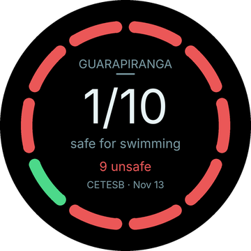
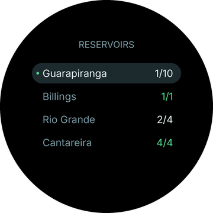
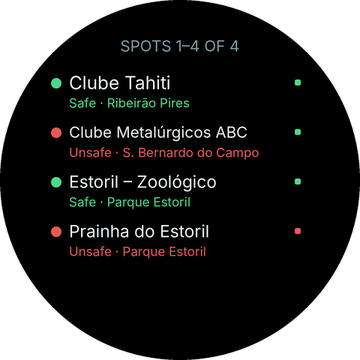
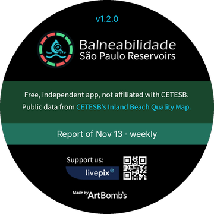
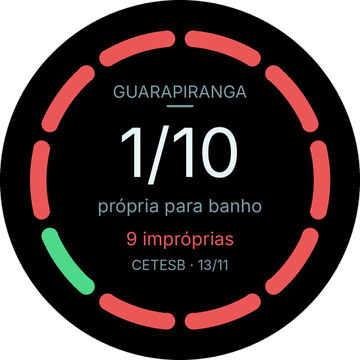
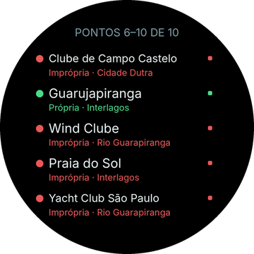
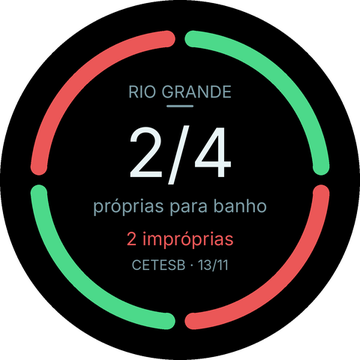
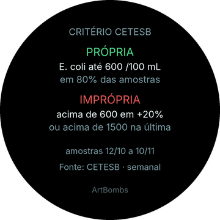

# Balneabilidade Represas SP — mini app Zepp OS

**PT** · Dá pra nadar? A classificação oficial da **CETESB** para as praias das represas da Grande São Paulo, no pulso: própria ou imprópria para banho, ponto a ponto, nas represas **Guarapiranga, Billings, Rio Grande e Cantareira**, com dados públicos do [Mapa de Qualidade das Praias Interiores](https://arcgis.cetesb.sp.gov.br/portal/apps/experiencebuilder/experience?id=5caf462c81a04896baf8f3916121b8ff).

**EN** · Is it safe to swim? CETESB's official bathing water ratings for the beaches of Greater São Paulo's reservoirs, on your wrist: safe or unsafe, spot by spot, at Guarapiranga, Billings, Rio Grande and Cantareira, from public data. The interface follows the watch language (English or Portuguese).

App independente, sem vínculo com a CETESB. Não coleta dados pessoais. · *Independent app, not affiliated with CETESB. No personal data collected.*

<p>
  
  
  
  
</p>
<p>
  
  
  
  
</p>

## Telas

1. **Resumo**: anel com um segmento por ponto de coleta (verde = própria, vermelho = imprópria, cinza = não classificada), placar (ex.: 1/10) e data do boletim. Toque no nome da represa, ou clique da coroa, para trocar de represa.
2. **Pontos 1–5** e 3. **Pontos 6–10**: nome da praia, situação, bairro ou rio e os boletins anteriores (quadradinhos à direita).
4. **Critério CETESB**: regra de *E. coli* e período das amostras.
5. **Sobre**: versão, data do boletim e QR de apoio (toque para ampliar).

## Relógios

Zepp OS com API 3.0+ e tela **redonda de 480 px** (a arte do Sobre não escala): Amazfit Balance, Balance 2, Balance 2 XT, Balance 3, Balance 3 Ti, Balance Ultra, T-Rex 3, T-Rex 3 Pro (48 mm), T-Rex Ultra 2, Cheetah 2 Ultra, Active Max e Cheetah Pro. Testado no Balance.

## Arquitetura

```
Relógio (page)  ──BLE──►  Zepp App (app-side)  ──HTTPS──►  arcgis.cetesb.sp.gov.br (ArcGIS FeatureServer)
  cache por represa        cache + histórico por represa     JSON público, sem chave
  /data/balne.json ──► mostradores podem ler (sempre Guarapiranga)
```

- O relógio não acessa a internet: quem consulta a CETESB é o **side service** dentro do Zepp App (`app-side/index.js`), via [ZML](https://github.com/zepp-health/zml).
- Ao abrir, o app mostra na hora o último boletim salvo e depois busca o novo. Sem conexão, fica o último salvo, marcado como offline.
- A camada da CETESB guarda só o retrato atual (uma linha por ponto). O **histórico** dos boletins é acumulado no celular, até 6 por ponto, uma entrada por data de relatório.
- `/data/balne.json` (só ASCII) pode ser lido por mostradores API 3 com `openSync({ path: 'balne.json', options: { appId: 1136314 } })`: `{"f":1,"s":"GUAR","d":"YYYY-MM-DD","p":<próprias>,"n":<total>,"ts":<ms>}`.

## Estrutura

| Caminho | Conteúdo |
|---|---|
| `page/index/index.page.js` | 5 telas, lista de represas, coroa, QR de apoio |
| `page/i18n.js` | Idioma pelo `getLanguage()` do relógio: português (pt-BR/pt-PT) ou inglês |
| `app-side/index.js`, `shared/cetesb.js` | Consulta à camada da CETESB, nomes curtos e bairros dos pontos, histórico e pacote compacto (~1,5 KB) para o relógio |
| `tools/` | Capturas da loja a partir dos widgets, arte do Sobre em inglês, arte de divulgação, build preview para QR |
| `test/` | Simulação do Zepp OS (mocks de `@zos/*`) com respostas reais da CETESB |

## Dados da CETESB (públicos, sem chave)

Camada `Hosted/PRAIAS_INTERIORES_DEFINITIVA/FeatureServer/0`, a mesma do mapa oficial:

```
https://arcgis.cetesb.sp.gov.br/server/rest/services/Hosted/PRAIAS_INTERIORES_DEFINITIVA/FeatureServer/0/query
  ?f=json&returnGeometry=false&orderByFields=pto_cetesb
  &outFields=pto_cetesb,praia,muncp,classific,classific_texto,agrup_classific,freq,drelatorio,perini,perfim
  &where=sist_hid_c IN ('GUAR')
```

| Represa no app | `sist_hid_c` | Pontos | Boletim |
|---|---|---|---|
| Guarapiranga | `GUAR` | 10 | semanal |
| Billings | `BILL` | 1 | semanal |
| Rio Grande | `RGDE` | 4 | semanal |
| Cantareira | `JCRE` + `RAIN` (Jacareí-Jaguari e Atibainha) | 4 | mensal |

- `agrup_classific`: Própria / Imprópria / Não Classificada. Nos pontos mensais, `classific = S` ("Sistematicamente boa") conta como própria.
- Critério CETESB: própria com *E. coli* até 600 UFC/100 mL em 80% das amostras; imprópria acima de 600 em mais de 20% ou acima de 1500 na última.
- `RAIN 00802` fica de fora (sem classificação desde abril de 2026; o mapa oficial também o esconde).
- Alto Tietê, Cotia, Rio Claro e São Lourenço não têm praias monitoradas.
- Os nomes curtos e a referência de cada ponto (bairro, ou o rio nas entradas de rio) ficam em `shared/cetesb.js`. Nomes de praias, represas, rios e bairros não são traduzidos.

## Compilar

Requer Node.js e a [Zeus CLI](https://docs.zepp.com/docs/guides/tools/cli/).

```bash
npm install
zeus preview                 # instala no relógio pelo QR (Zepp App › modo desenvolvedor)
zeus build                   # gera dist/*.zab (modo production) para a loja
node tools/build_preview.js  # gera dist/*.zab em modo preview, todos os relógios: os .zpk de dentro servem para QR zpkd1://
```

O scanner do modo desenvolvedor do Zepp App só aceita pacotes **preview** ("Only preview packages are supported"). Por isso o `.zab` da loja (production) e os `.zpk` para QR saem de comandos diferentes.

O `appId` 1136314 é registrado no Zepp Console do autor. Para publicar um fork, registre um app próprio e troque o `appId` no `app.json`.

## Testes

```bash
node test/harness.mjs                 # português
LANG_ZEPP=2 node test/harness.mjs     # inglês (2 = en-US)
```

## Licença

- **Código** (`.js`, `.mjs`, `.py`): [MIT](LICENSE).
- **Arte** (ícone, tela Sobre, QR em `assets/` e as imagens de `docs/`) e a marca **ArtBombs**: todos os direitos reservados, ver [ASSETS-LICENSE.md](ASSETS-LICENSE.md).
- Os dados são da CETESB (Mapa de Qualidade das Praias Interiores), consultados em tempo real; este repositório não os redistribui, exceto amostras para testes.

Feito por **ArtBombs**.
